<h1 align="center">MailNex · 邮件管理系统</h1>

<p align="center"><strong>把一套企业邮件系统，装进一个可执行文件。</strong></p>

<p align="center">
  <a href="docs/assets/hero.webp">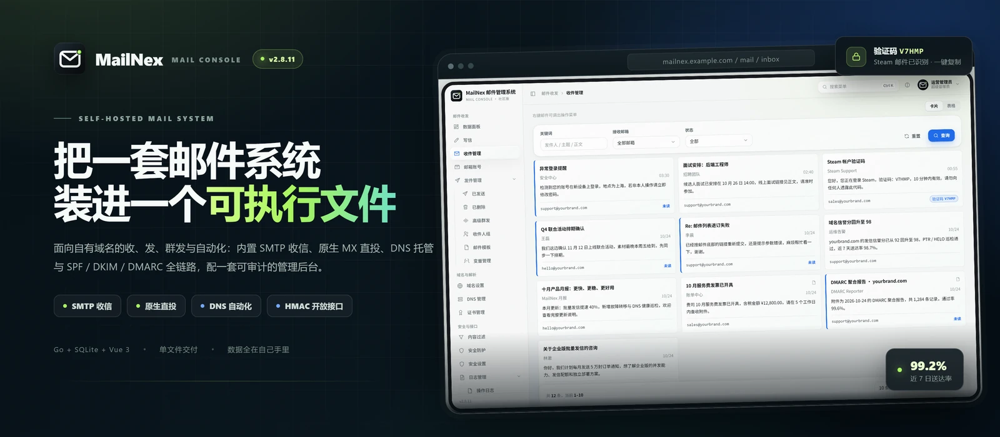</a>
</p>

<p align="center">
  
  
  
  
  
  <a href="LICENSE"></a>
</p>

MailNex 是一套**可自托管的自有域名邮件系统**。它把 SMTP 收信、MX 直投、DNS 托管、SPF / DKIM / DMARC、群发、验证码提取、开放接口与审计后台，收进一个可执行文件。

不需要 Postfix + Dovecot + Nginx + MySQL，不需要 Redis，也不依赖第三方发信平台。运行一个文件，浏览器进后台，邮件与数据都在自己的机器上。

> [!WARNING]
> MailNex 自带 SMTP 收信与 MX 直投，不是普通 Web 后台。生产部署必须有可绑定的**公网 IPv4**，并放通**入站与出站 TCP 25**；多数云厂商默认封禁出站 25，需要单独申请解封。

<p align="center">
  <a href="#为什么是-mailnex">为什么</a> ·
  <a href="#功能全景">功能全景</a> ·
  <a href="#界面一览">界面一览</a> ·
  <a href="#开放接口">开放接口</a> ·
  <a href="#架构与技术栈">架构</a> ·
  <a href="#快速开始">快速开始</a> ·
  <a href="#部署前提">部署前提</a> ·
  <a href="#配置">配置</a>
</p>

## 为什么是 MailNex

| 常见做法 | 在 MailNex 里 |
| --- | --- |
| 拼 Postfix、Dovecot、Nginx、MySQL，再请人配 SPF / DKIM / DMARC | 一个进程、一个 SQLite 文件、一个 `data` 目录 |
| 群发工具只管发，收信、退信、投递结果分散在几套系统 | 收件、发件、群发、退信与投递回执在同一个后台 |
| 业务系统要验证码，只能让开发去轮询 IMAP | 一个 HMAC 接口直接取最新 Steam 验证码 |
| 出问题后日志散在五六个地方，无法还原一封邮件走了哪条路 | 操作、安全、风控、投递日志统一查看 |
| 迁移服务器要重装数据库、Web 容器和一堆依赖 | 拷走可执行文件与 `data` 目录即可保留全部数据 |

它适合这些场景：

- 用自有域名接验证码、客服信箱、业务回执；
- 不想维护 Postfix 全家桶，又需要真实收信与直投；
- 想给产品加“建号、发信、读信、取验证码”的能力；
- 需要投递日志、登录审计与接口风控的团队。

## 功能全景

| 模块 | 关键能力 |
| --- | --- |
| 收件管理 | 内置 SMTP 收信、STARTTLS、任意前缀自动建箱、卡片 / 表格双视图、6 秒轮询、原始 EML 与附件落盘、Steam 验证码自动提取 |
| 写信与发件 | 整页富文本编辑器、附件、抄送密送、定时发送、已读回执、纯文本 / 加密、发件人关键字搜索、SMTP 中继 |
| 发件中心 | 直投收件人 MX、队列与重试、租约 watchdog、死信、DSN 退信、域名级限速、退信率自动降速、逐封 SMTP 回执 |
| 高级群发 | 收件人组、邮件模板、变量替换、发信分组轮转分摊、一键退订头、Feedback-ID、按收件人记录投递结果 |
| 邮箱账号 | 手工建号、按数量 / 位数 / 字符集批量生成、批量删除与复制、发信分组、单账号每日发信上限 |
| 域名与 DNS | 自动生成 DKIM 与 A / MX / SPF / DKIM / DMARC 五类记录、阿里云 / DNSPod / Cloudflare 推送与拉取、严格校验、PTR / HELO 巡检 |
| 证书 | 上传自有证书，或通过 ACME DNS-01 一键申请 Let's Encrypt，用于收信 STARTTLS 与 587 提交 |
| 安全与审计 | 入站 SPF / DKIM / DMARC、灰名单、内容过滤、IP 黑白名单、限流、自动封禁、登录锁定、操作 / 安全 / 风控日志 |
| 开放接口 | HMAC-SHA256 签名、全局密钥、时间戳与 Nonce 防重放、IP 白名单、限流与每日配额、调用审计 |
| 系统管理 | 用户、角色与按钮权限、菜单、意见反馈、关于与版本更新；数据面板汇总收发与队列状态 |
| 交付与体验 | Go + SQLite 单二进制，前端 `go:embed`；Vue 3 自有组件与珍珠玻璃设计语言，适配移动端 |

## 界面一览

以下截图来自 **v2.8.11** 演示环境。域名、邮箱、IP、验证码与接口密钥均为示例数据，不包含真实凭据。

### 收件管理

收件箱按 **6 秒静默轮询**，新邮件自动出现；支持卡片与表格两种视图，按方向、状态、关键词筛选，未读、垃圾、归档状态一目了然。

- 域名启用后，任意前缀地址都会自动建箱并接收邮件，不需要为每个地址单独开启“全量收信”。
- 正文、原始 EML 与附件全部落磁盘，数据库只保存路径、摘要与列表预览，库体量不会随邮件增长失控。
- 被内容过滤标记的邮件带“垃圾”标签，可以在正常 / 垃圾之间手动切换。
- 目前自动识别 **Steam 官方邮件**（`steampowered.com` / `steamcommunity.com`）的 5 位验证码；其他发件人一律不猜，避免把正文里的普通数字当成验证码。

<p align="center">
  <a href="docs/assets/screenshots/inbox.webp">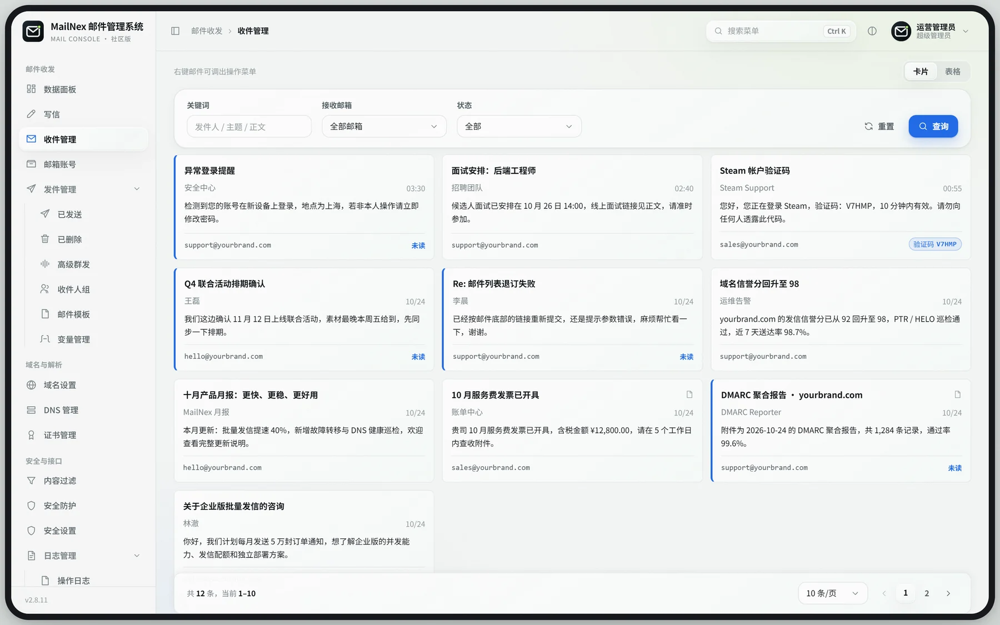</a>
</p>
<p align="center"><sub>收件管理 · 卡片视图、筛选与验证码胶囊</sub></p>

<p align="center">
  <a href="docs/assets/screenshots/inbox-detail.webp">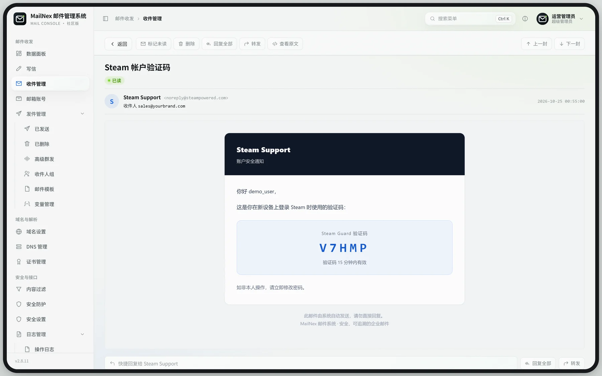</a>
</p>
<p align="center"><sub>邮件详情 · 正文、附件与原始邮件</sub></p>

### 写信与发件

写信页是整页富文本编辑器，嵌在后台右侧内容区，左侧导航随时切换。顶部是发送、预览、存草稿、取消；邮件头支持发件人、收件人、抄送、密送、主题与附件；正文支持加粗、颜色、字号、列表、对齐、链接、表格、分割线与表情；底部可勾选紧急、已读回执、纯文本、邮件加密，并设置定时发送。

发件人不是下拉列表，而是**关键字搜索框**：账号成百上千时，打字即搜（走服务端 `keyword` 查询，每次最多 20 条），回车或点击选中。发件中心选发信邮箱也是同一套交互。

<p align="center">
  <a href="docs/assets/screenshots/compose.webp">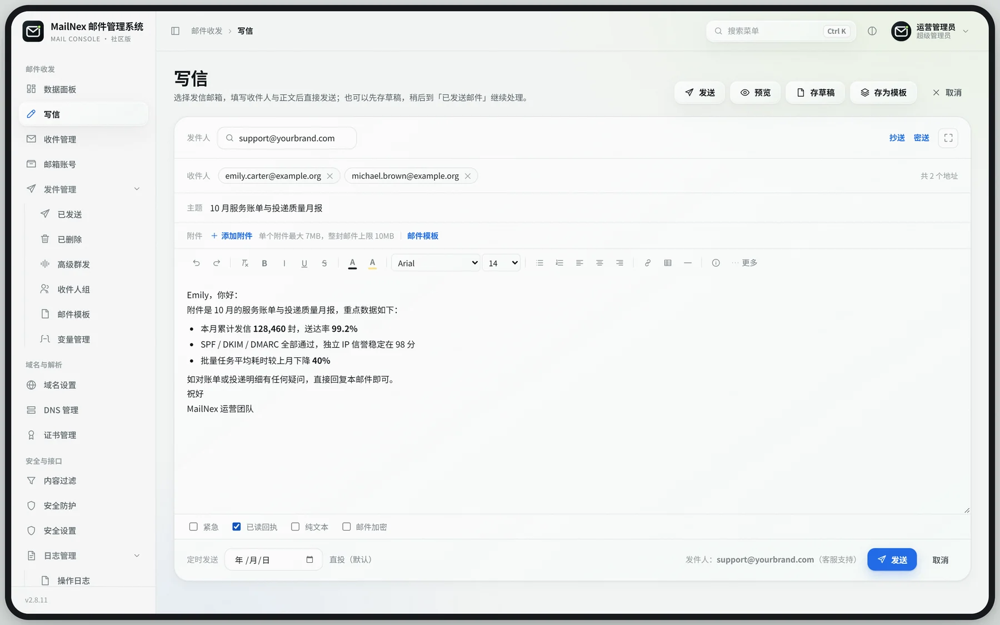</a>
</p>
<p align="center"><sub>写信 · 富文本、收件人标签、定时与回执选项</sub></p>

“已发送邮件”按任务跟踪，列表 15 秒静默轮询，“投递中”会自动变成“投递成功 / 失败”。点进去能看到逐封收件人的 SMTP 返回码、MX 尝试阶梯、失败分类与重试次数。

<p align="center">
  <a href="docs/assets/screenshots/outbound.webp">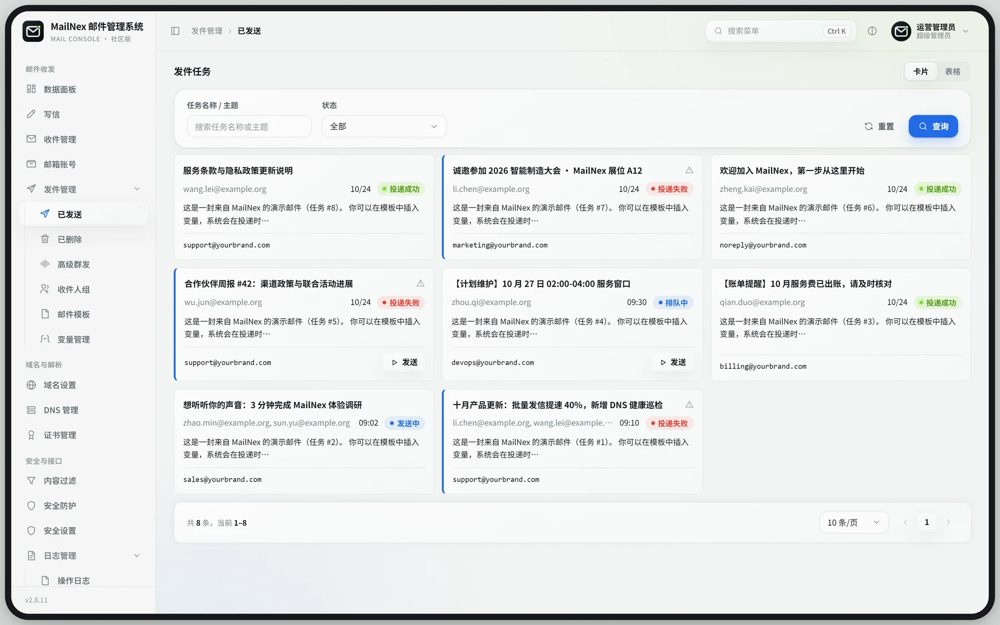</a>
</p>
<p align="center"><sub>发件中心 · 任务状态与逐封投递结果</sub></p>

投递链上该有的能力都在这条链路里：

- **直投优先**：Go 原生查询收件人 MX，用服务器公网 IP 直接投递，不依赖 Postfix 或第三方中继。
- **可选 SMTP 中继**：在系统设置里配置并启用外部 SMTP 凭据后，写信页才会出现“SMTP 中继”选项；凭据使用 AES-GCM 加密存储，支持连通性测试。
- **队列与重试**：发信租约 + watchdog，卡在 `sending` 的任务自动退回队列；超过最大次数进入死信。
- **DSN 退信**：死信自动生成标准退信报告，信封发件人固定为 `<>`，不会形成退信循环。
- **实时预检**：公网 IPv4、出站 25、入站 25 在每次发信前校验，不满足直接报「直投不可用」，不会假装发送成功。

### 高级群发

高级群发以“收件人组”为单位建单，一张卡跟踪一个名单的累计送达、失败与待投递。一次群发可以用「发信分组」把多个邮箱账号（可跨域名）编成一组，收件人按顺序轮转分摊，避免单 IP、单域名被打上“批量发送”标签。

群发自动附带 `List-Unsubscribe`（RFC 2369 + RFC 8058 一键退订）与 `Feedback-ID`，满足 Gmail / Microsoft 对正规批量发件方的要求。名单、模板、变量三者解耦：收件人组管“发给谁”，模板管“长什么样”，变量管“哪里替换”。

<p align="center">
  <a href="docs/assets/screenshots/bulk.webp">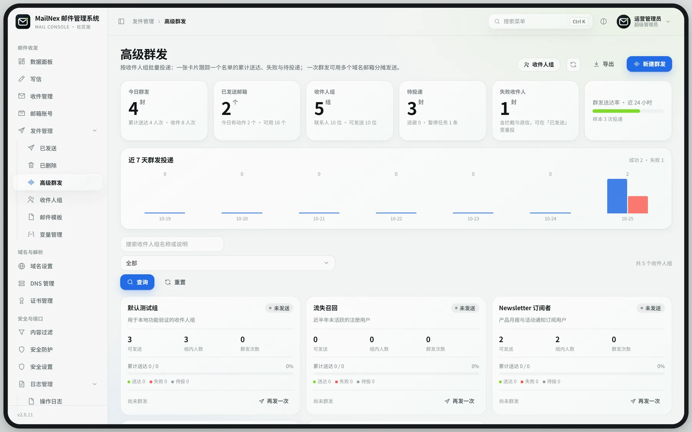</a>
</p>
<p align="center"><sub>高级群发 · 送达率、待投递与失败跟踪</sub></p>

<p align="center">
  <a href="docs/assets/screenshots/groups.webp">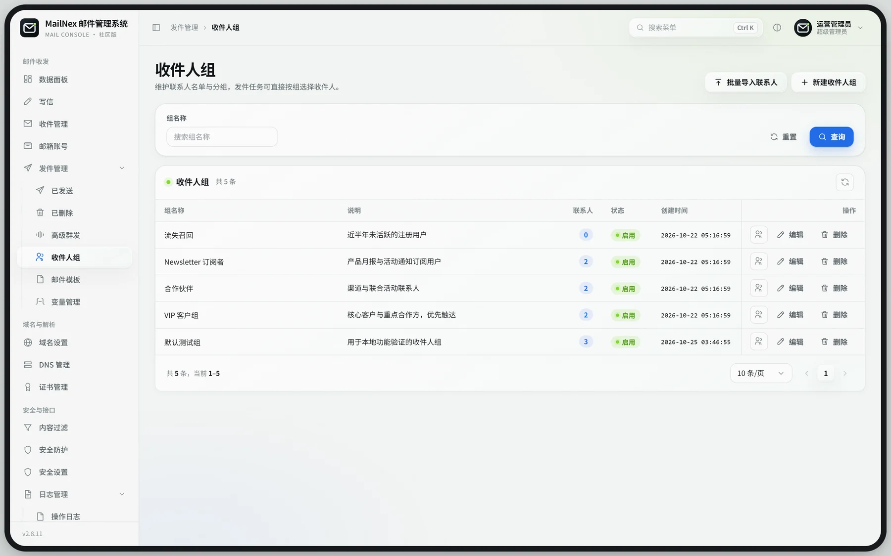</a>
  <a href="docs/assets/screenshots/templates.webp">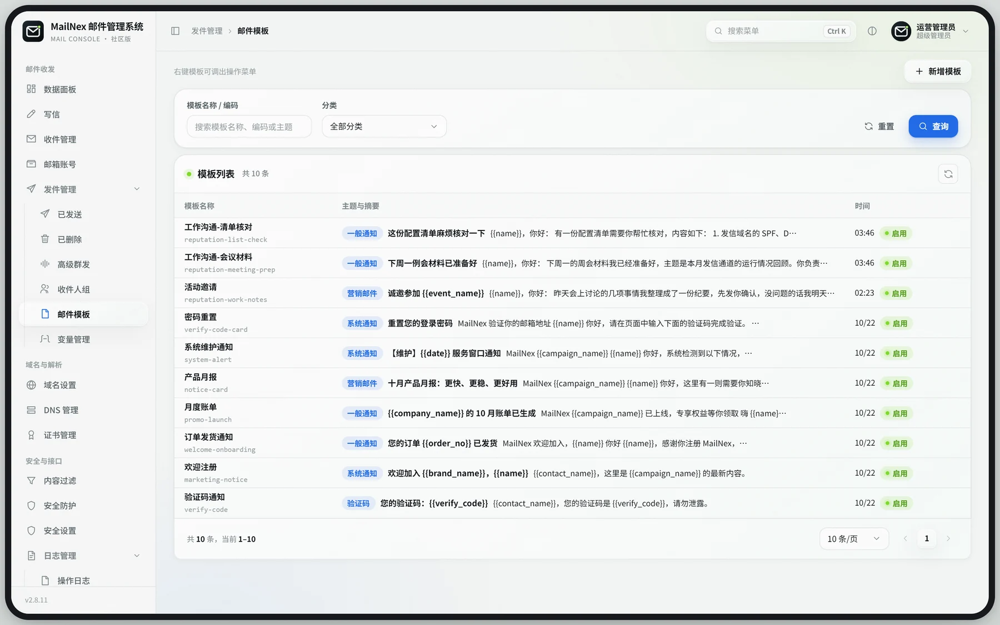</a>
  <a href="docs/assets/screenshots/variables.webp">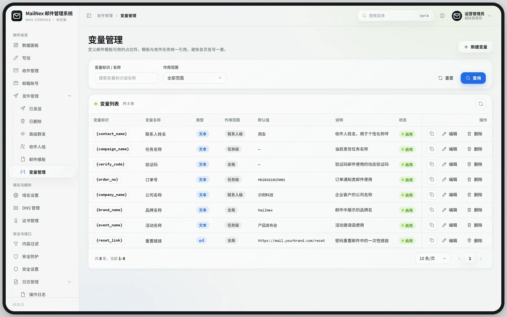</a>
</p>
<p align="center"><sub>收件人组 · 邮件模板 · 变量管理</sub></p>

### 邮箱账号

一个域名下可以创建任意多个邮箱账号；地址为「固定前缀 + 随机字符」，支持按数量、位数、字符类型批量生成。批量删除、复制地址、修改每日上限都在列表上完成。

收发权限由域名统一控制，单账号默认每日发信上限 **200 封**。勾选一批账号可以导入「发信分组」，供高级群发轮转分摊。

<p align="center">
  <a href="docs/assets/screenshots/accounts.webp">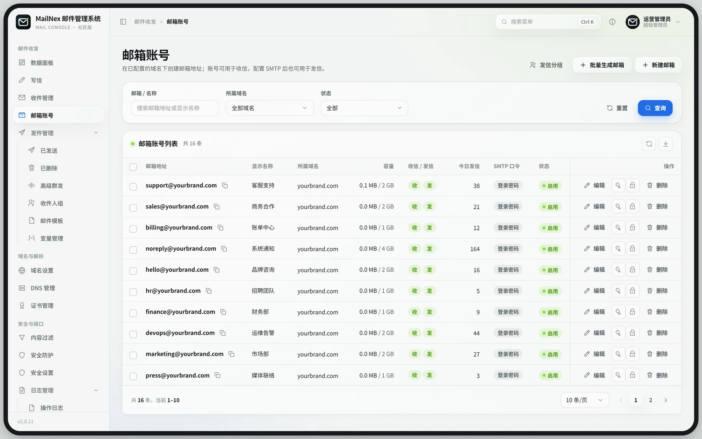</a>
</p>
<p align="center"><sub>邮箱账号 · 批量生成、发信分组与每日上限</sub></p>

### 域名、DNS 与证书

域名是收信域，添加后系统自动生成 DKIM 密钥与全套 DNS 记录。把最容易出错的一段做成闭环：

1. 在「域名设置」添加域名，填写服务器公网 IP；系统生成 **A / MX / SPF / DKIM / DMARC** 五类记录。
2. 在「DNS 管理」新增解析服务商凭据（阿里云 / 腾讯云 DNSPod / Cloudflare），测试连接后**一键推送到云端**。
3. 也可以反向「从云端拉取」，把已有解析导入本地。
4. 点「校验该域名」，严格逐条比对线上解析与本地配置，全部一致才置为就绪。
5. 从外部网络确认 `公网IP:25` 可连接，并检查 MX、A、SPF 与 PTR 是否一致。

<p align="center">
  <a href="docs/assets/screenshots/domains.webp">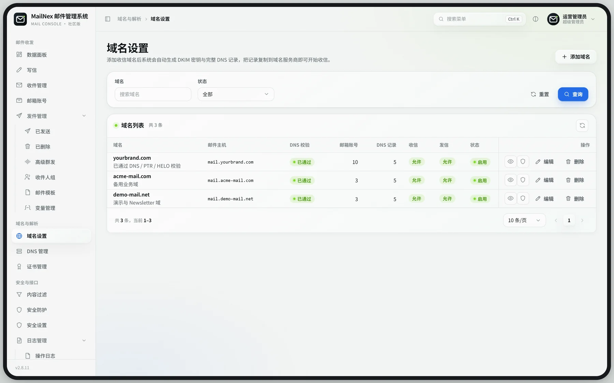</a>
  <a href="docs/assets/screenshots/dns.webp">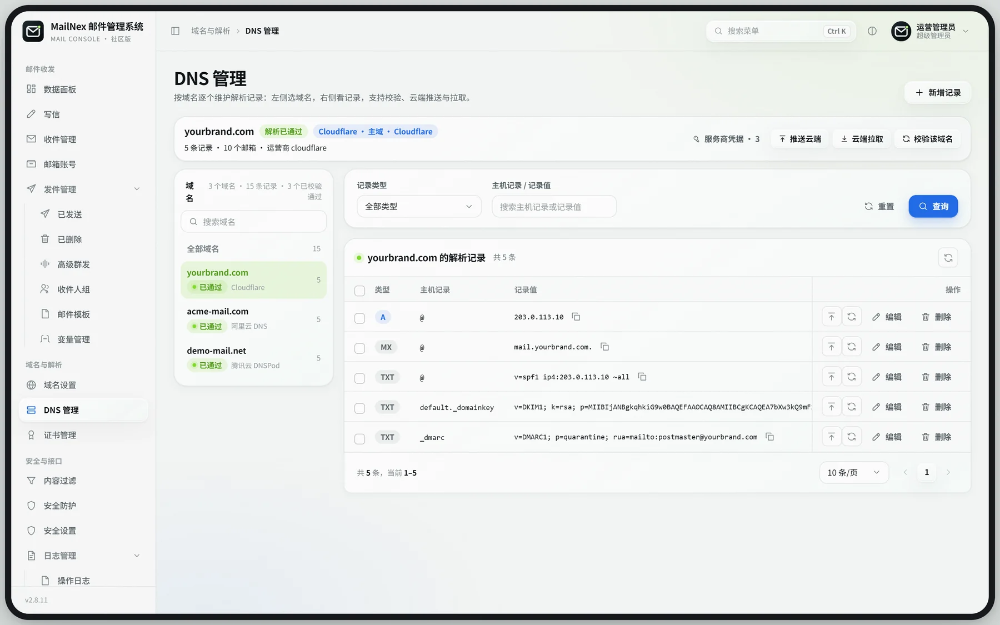</a>
</p>
<p align="center"><sub>域名设置 · DNS 管理与服务商推送</sub></p>

校验会额外抓两类常见坑：MX 目标解析不出地址（悬空记录），以及线上 DKIM 公钥与本地签名私钥不是一对（外发邮件必然验不过）。开发机挂代理时 DNS 会被劫持成 fake-IP，可用 `MAILNEX_DNS_RESOLVER=223.5.5.5` 指定公共解析器。

PTR / HELO 有独立配置向导，按顺序给出“该加哪几条记录、去哪儿加”；域名健康检查每 30 分钟巡检一次，PTR 对不上会直接标红。

证书按域名管理，用于发信 TLS 与收信 STARTTLS：可以上传自有证书，也可以通过 ACME **DNS-01** 一键申请 Let's Encrypt（不需要暴露 80 端口）。

### 安全与审计

安全防线分三层，入站、出站、接口各有对应策略。

**入站**：SPF 校验、DKIM 验签、DMARC 策略判定；灰名单按「来源 IP + 发件人 + 收件人」三元组退避，同域与回环地址自动跳过，不会自伤。

**内容过滤**：在收信落盘前按优先级逐条匹配主题、发件人、正文、体积、附件数，支持四类动作——标垃圾 / 退信 / 静默丢弃 / 转发。表单内置「样例试跑」，先粘一封真实邮件验证正则，再保存上线。

**入口与后台**：单 IP 限流、自动封禁、登录失败锁定、请求体上限、扫描路径拦截、IP 白名单，全部可视化配置；封禁列表可手动增删。

<p align="center">
  <a href="docs/assets/screenshots/filters.webp">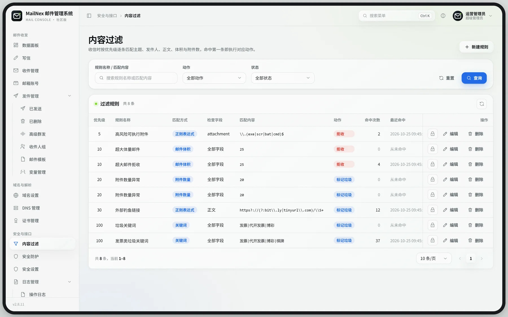</a>
  <a href="docs/assets/screenshots/security.webp">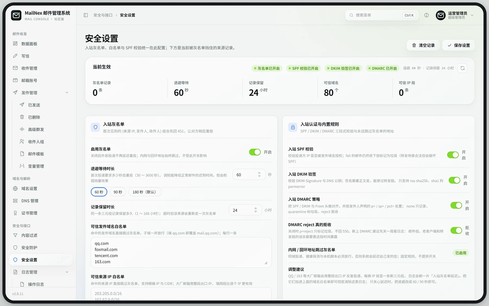</a>
</p>
<p align="center"><sub>内容过滤 · 安全防护</sub></p>

日志统一收在「日志管理」：操作日志记录后台所有写操作、操作对象、脱敏参数、结果与耗时；安全日志覆盖登录、登出、改密、找回密码与绑定变更；风控日志记录接口鉴权失败、重放、越权、限流与入站拦截，并附接口调用审计视图。

<p align="center">
  <a href="docs/assets/screenshots/oplog.webp">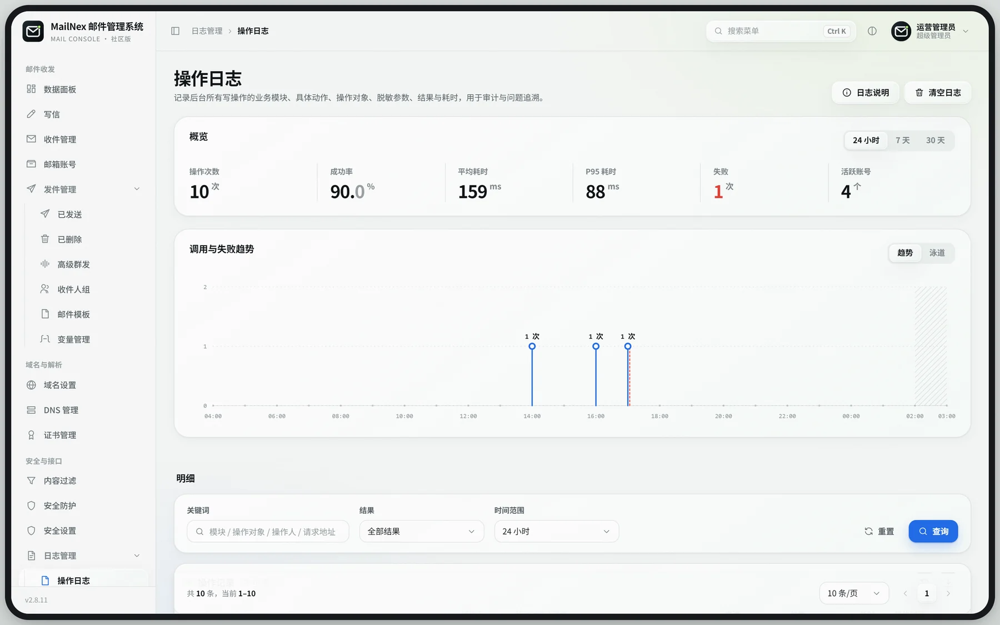</a>
  <a href="docs/assets/screenshots/risklog.webp">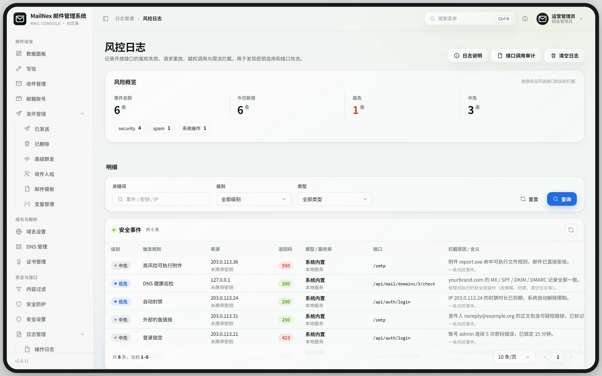</a>
  <a href="docs/assets/screenshots/securitylog.webp">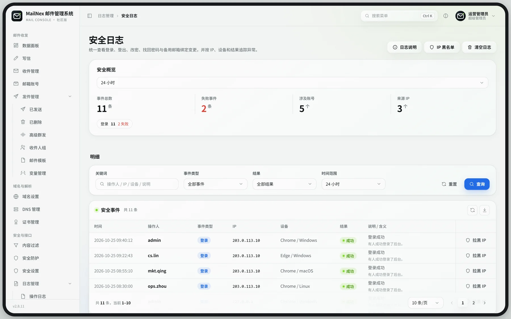</a>
</p>
<p align="center"><sub>操作日志 · 风控日志 · 安全日志</sub></p>

### 系统管理

菜单围绕邮件业务编排，保留系统账号、角色权限、菜单、日志与意见反馈这些必要能力；与邮件无关的部门、岗位、字典、参数与代码生成页面不再占据菜单，对应后端能力保留，用于用户部门下拉、字典选项与角色授权。

角色权限支持菜单与按钮级授权，页面提供权限矩阵和逐项勾选两种视图。

<p align="center">
  <a href="docs/assets/screenshots/users.webp">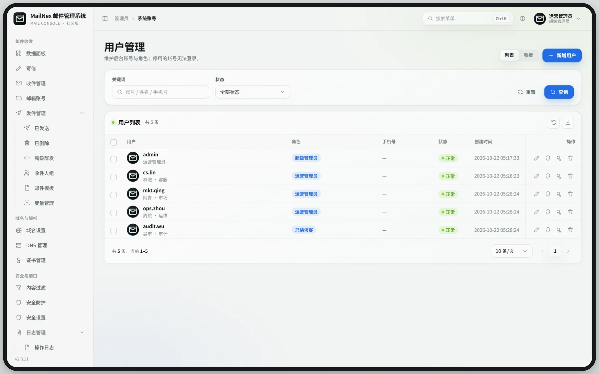</a>
  <a href="docs/assets/screenshots/roles-matrix.webp">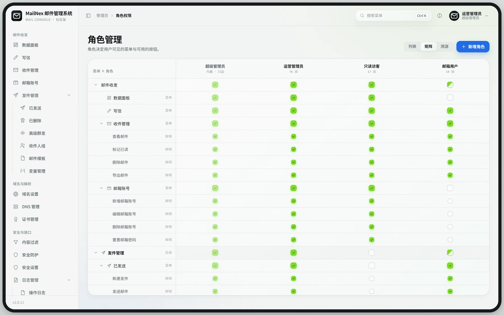</a>
</p>
<p align="center"><sub>用户管理 · 角色权限矩阵</sub></p>

<p align="center">
  <a href="docs/assets/screenshots/roles-permissions.webp">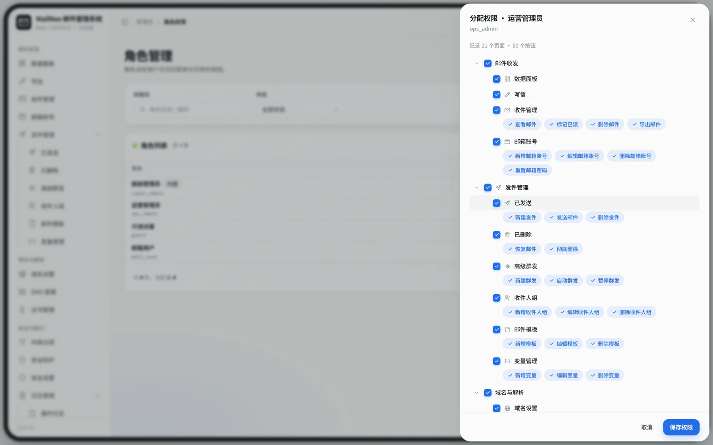</a>
  <a href="docs/assets/screenshots/about.webp">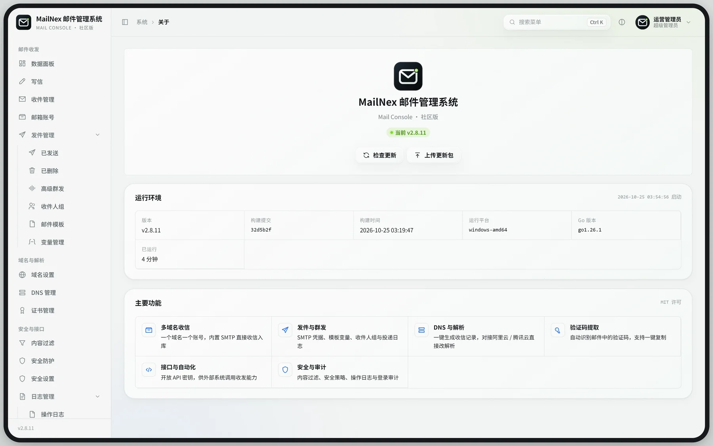</a>
</p>
<p align="center"><sub>权限勾选 · 关于与更新</sub></p>

「意见反馈」可以把问题提交到 Orbit 中控，并在本机查看历史与回复；「关于」展示版本、构建提交与时间、运行平台、Go 版本与运行时长，并按平台管理发布包：拖拽上传二进制、标记最新、复制 SHA256、下载、删除，以及一键「应用更新」。

### 移动端

后台使用同一套 Vue 3 组件与珍珠玻璃设计语言，在 820px 以下切换为移动布局：侧栏收起为抽屉，筛选区与表格自动重排，登录、收件与详情都能在手机上完成。

<p align="center">
  <a href="docs/assets/screenshots/login-mobile.webp">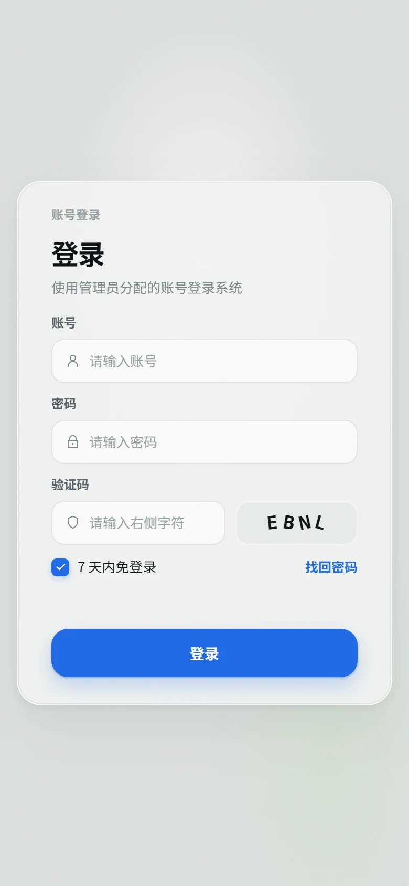</a>
  <a href="docs/assets/screenshots/inbox-mobile.webp">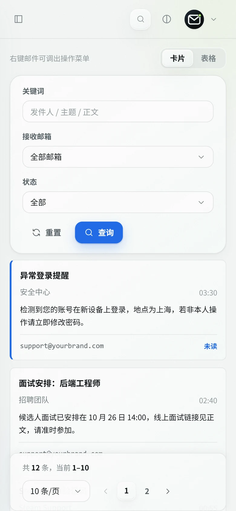</a>
</p>
<p align="center"><sub>移动端登录 · 移动端收件箱</sub></p>

## 开放接口

「管理员 → 接口管理」提供密钥管理与接口文档：创建、停用、吊销 AccessKey，查看签名规则、接口清单、参数说明与调用示例。

密钥是**全局密钥**：一个密钥可以操作全部域名下的邮箱账号，权限由密钥绑定的角色决定；SecretKey 使用 AES-GCM 加密存储，列表只显示前缀，创建后只回显一次。SecretKey 不参与网络传输，AccessKey 单独泄露也调不通。

<p align="center">
  <a href="docs/assets/screenshots/api.webp">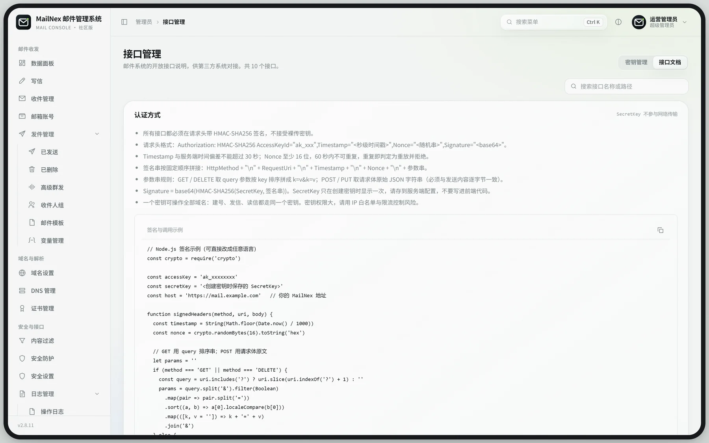</a>
</p>
<p align="center"><sub>接口文档 · 签名规则、接口清单与调用示例</sub></p>

### 签名规则

请求头格式：

```http
Authorization: HMAC-SHA256 AccessKeyId="ak_xxx",Timestamp="1760000000",Nonce="<32位随机串>",Signature="<base64>"
```

签名串固定为：

```text
HttpMethod \n RequestPath \n Timestamp \n Nonce \n 参数串
```

- GET / DELETE 的“参数串”是**解码后的 query 参数**，按 key 升序拼成 `k=v&k=v`；同名参数只取第一个值。
- POST / PUT 的“参数串”是**请求体原始 JSON 字符串**，必须与实际发送的字节完全一致。
- `Timestamp` 为 Unix 秒，允许 ±30 秒；`Nonce` 至少 16 个字符，60 秒内不可重复。
- `Signature = base64(HMAC-SHA256(SecretKey, 签名串))`。

### 接口清单

| 方法 | 路径 | 说明 |
| --- | --- | --- |
| GET | `/api/open/ping` | 连通性探测，只需签名 |
| POST | `/api/open/mail/accounts` | 创建邮箱账号，请求体带 `domain` 与地址前缀 |
| GET | `/api/open/mail/accounts` | 查询账号 |
| GET | `/api/open/mail/domains` | 查询域名 |
| POST | `/api/open/mail/send` | 发送邮件；`accountId` 指定发信账号，或用 `domain` 指定发信域名 |
| GET | `/api/open/mail/messages` | 收件列表，可用 `accountId` 缩小范围 |
| GET | `/api/open/mail/messages/{id}` | 邮件详情 |
| GET | `/api/open/mail/messages/latest` | 按 `email` 或 `accountId` 取最新一封 |
| GET | `/api/open/mail/verification-code` | 取最新 Steam 验证码，可选 `maxAge`（秒） |
| POST | `/api/open/mail/messages/status` | 标记已读 / 未读 / 归档 |

默认限流 **120 次/分钟**，每个密钥可配置每日配额（0 表示不限）与来源 IP 白名单。每次调用落审计日志；鉴权失败、重放、越权与限流进入风控日志。

### 调用示例

```python
import base64, hashlib, hmac, secrets, time
import requests

base = "https://mail.example.com"
access_key = "ak_xxx"
secret_key = "sk_xxx"

method, path = "GET", "/api/open/mail/verification-code"
params = {"email": "service@yourbrand.com"}
canonical = "&".join(f"{k}={params[k]}" for k in sorted(params))

ts = str(int(time.time()))
nonce = secrets.token_hex(16)
sign_string = "\n".join([method, path, ts, nonce, canonical])
signature = base64.b64encode(
    hmac.new(secret_key.encode(), sign_string.encode(), hashlib.sha256).digest()
).decode()

resp = requests.get(
    base + path,
    params=params,
    headers={
        "Authorization": (
            f'HMAC-SHA256 AccessKeyId="{access_key}",Timestamp="{ts}",'
            f'Nonce="{nonce}",Signature="{signature}"'
        )
    },
    timeout=10,
)
print(resp.status_code, resp.text)
```

> [!NOTE]
> 上面的 `params` 只用于签名与发起请求；签名串里使用的是解码后的值（例如 `service@yourbrand.com`），不要先做 URL 编码再拼签名串。

## 架构与技术栈

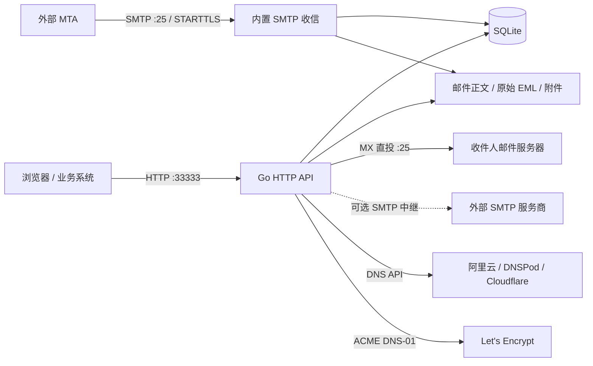

| 层 | 选型 | 说明 |
| --- | --- | --- |
| 后端 | Go 1.21+、`net/http`、`database/sql` | 单进程，无 Java / PHP 运行时 |
| 数据库 | SQLite（`modernc.org/sqlite`） | 纯 Go 驱动，无 CGO，单文件即可运行 |
| 前端 | Vue 3、TypeScript、Vite 6、Vue Router 4、GSAP 3 | 自有组件库与“珍珠玻璃”设计语言，不依赖 Element Plus |
| 邮件存储 | 磁盘文件 + SQLite 索引 | 正文、原始 EML、附件落盘；数据库存路径、摘要与预览 |
| 交付 | `go:embed` + 单二进制 | 前端页面、接口、表结构与种子数据都在一个文件里 |

## 快速开始

MailNex 交付为单文件可执行程序。前往 [Releases](https://github.com/MailNex/MailNex-/releases) 下载对应平台的产物（完整性校验见发行包里的 `SHA256SUMS.txt`）：

| 平台 | 产物 |
| --- | --- |
| Windows x64 | [`mailnex-2.8.11-windows-x64.exe`](https://github.com/MailNex/MailNex-/releases/download/v2.8.11/mailnex-2.8.11-windows-x64.exe) |
| Linux x64 | [`mailnex-2.8.11-linux-x64`](https://github.com/MailNex/MailNex-/releases/download/v2.8.11/mailnex-2.8.11-linux-x64) |
| Linux arm64 | [`mailnex-2.8.11-linux-arm64`](https://github.com/MailNex/MailNex-/releases/download/v2.8.11/mailnex-2.8.11-linux-arm64) |
| macOS x64 | [`mailnex-2.8.11-macos-x64`](https://github.com/MailNex/MailNex-/releases/download/v2.8.11/mailnex-2.8.11-macos-x64) |
| macOS arm64 | [`mailnex-2.8.11-macos-arm64`](https://github.com/MailNex/MailNex-/releases/download/v2.8.11/mailnex-2.8.11-macos-arm64) |

首次启动会在可执行文件所在目录创建 `data` 目录（SQLite 数据库 + 邮件存储），确保该目录可写。

```powershell
.\mailnex-2.8.11-windows-x64.exe
```

Linux / macOS 先赋予执行权限再运行：

```bash
chmod +x mailnex-2.8.11-linux-x64
./mailnex-2.8.11-linux-x64
```

浏览器打开 `http://localhost:33333`，默认管理员 `admin` / `admin123`。

> [!IMPORTANT]
> 首次登录后立即修改默认密码，并在生产环境设置独立的 `JWT_SECRET`（至少 32 字节）。示例账号与密钥均为占位，接入真实环境前必须替换。

<p align="center">
  <a href="docs/assets/screenshots/login.webp"></a>
</p>
<p align="center"><sub>登录页 · 珍珠玻璃视觉与验证码</sub></p>

## 部署前提

| 项目 | 要求 |
| --- | --- |
| 公网 IPv4 | 必须有可绑定的公网 IPv4；不支持只有 IPv6、内网或回环地址的部署 |
| 入站 TCP 25 | 云安全组、云防火墙、主机系统防火墙全部放行，外部 MX 才能投递进来 |
| 出站 TCP 25 | 未被云厂商封禁，直投才能连接收件人的 MX；多数云厂商默认限制，需要单独申请 |
| DNS | A 记录与 SPF 必须包含实际发信的公网 IPv4；PTR 建议指向邮件主机名 |
| 数据目录 | 可执行文件同级的 `data` 目录必须可写 |
| 端口 | Web `33333`、SMTP `25`、Submission `587`（均可通过环境变量修改） |

生产环境建议至少配置：

```dotenv
MAILNEX_PUBLIC_IP=你的公网IPv4
MAILNEX_MAIL_HOST=mail.example.com
MAILNEX_SMTP_ADDR=:25
MAILNEX_SMTP_ENABLED=true
JWT_SECRET=至少32字节的随机字符串
```

启动时会检查公网 IPv4、出站 25 与入站 25，**默认只打印提示，不拦截启动**：预检不过时更需要进后台看日志、改配置、查原因。需要“预检不过就拒绝启动”的强约束时，显式设置：

```dotenv
MAILNEX_PREFLIGHT_STRICT=true
```

配置好安全组与防火墙后，从**另一台公网机器**执行：

```bash
nc -vz YOUR_PUBLIC_IP 25
nc -vz gmail-smtp-in.l.google.com 25
```

两条命令都必须成功。第一条失败通常是入站安全组或主机防火墙未放行；第二条失败通常是云厂商封了出站 25。出站 25 被封时直投会逐封失败，收信不受影响。

## 配置

全部配置通过环境变量覆盖。除本地开发外，邮件相关配置不应依赖默认值。

```powershell
$env:MAILNEX_ADDR = ':9000'
$env:MAILNEX_DATA_DIR = 'D:\mailnex-data'
$env:JWT_SECRET = '替换为至少32字节的随机字符串'
.\mailnex-2.8.11-windows-x64.exe
```

<details>
<summary><strong>展开完整环境变量表</strong></summary>

| 变量 | 中文说明 | 默认值 |
| --- | --- | --- |
| `MAILNEX_ADDR` | HTTP 监听地址 | `:33333` |
| `MAILNEX_DATA_DIR` | 数据目录，存放数据库与邮件文件 | `./data` |
| `MAILNEX_DB` | SQLite 数据库文件路径 | `<数据目录>/mailnex.db` |
| `JWT_SECRET` | JWT 签名密钥，至少 32 字节；生产环境必须覆盖 | 内置开发密钥 |
| `MAILNEX_TOKEN_EXPIRE_SECONDS` | 登录令牌有效期，单位秒 | `7200` |
| `MAILNEX_REMEMBER_EXPIRE_SECONDS` | 勾选“7 天内免登录”时的有效期，单位秒 | `604800`（7 天） |
| `MAILNEX_ATTACH_DIR` | 附件存储目录 | `<数据目录>/attachments` |
| `MAILNEX_BODY_DIR` | 邮件正文与原始 EML 存储目录 | `<数据目录>/messages` |
| `MAILNEX_SMTP_ADDR` | SMTP 收信监听地址 | `:25` |
| `MAILNEX_SMTP_ENABLED` | 是否启用 SMTP 收信服务 | `true` |
| `MAILNEX_MAIL_HOST` | 邮件服务器主机名，用于生成 MX 记录 | 留空则用 `mail.域名` |
| `MAILNEX_PUBLIC_IP` | 服务器公网 IPv4，用于生成 A 与 SPF，并绑定直投出口；不接受 IPv6 | 空（启动时自动探测） |
| `MAILNEX_PREFLIGHT_STRICT` | 预检不通过时是否拒绝启动 | `false` |
| `MAILNEX_SMTP_CERT` | 收信 STARTTLS 正式证书路径；留空使用自动生成证书 | 空 |
| `MAILNEX_SMTP_KEY` | 收信 STARTTLS 私钥路径 | 空 |
| `MAILNEX_DKIM_SELECTOR` | 默认 DKIM 选择器 | `default` |
| `MAILNEX_SEND_CONCURRENCY` | 全局限流信号量：所有发信链路共享的并发投递上限 | `4` |
| `MAILNEX_SEND_LEASE_MINUTES` | 发信租约分钟数，`sending` 超过该时长由 watchdog 退回队列 | `15` |
| `MAILNEX_SEND_MAX_ATTEMPTS` | 单封邮件最大投递次数（含首次），超过后进死信 | `5` |
| `MAILNEX_DEAD_LETTER_TTL_HOURS` | 死信收件人明细保留小时数，投递日志不删 | `720`（30 天） |
| `MAILNEX_DOMAIN_RATE_PER_MINUTE` | 单个收件域每分钟最多投递封数，`0` 表示不限 | `60` |
| `MAILNEX_SUBMISSION_PER_MINUTE` | 每分钟最多新建发件任务数，`0` 表示不限 | `120` |
| `MAILNEX_GREYLIST_BASE_SECONDS` | 灰名单首次退避秒数（同域名 4xx 后） | `60` |
| `MAILNEX_GREYLIST_MAX_SECONDS` | 灰名单最大退避秒数 | `1800` |
| `MAILNEX_BOUNCE_ENABLED` | 死信是否自动生成 DSN 退信（信封发件人固定为 `<>`） | `true` |
| `MAILNEX_SUBMISSION_ADDR` | 587 Submission 监听地址（客户端发信提交口） | `:587` |
| `MAILNEX_SUBMISSION_ENABLED` | 是否启用 587 Submission 服务 | `true` |
| `MAILNEX_SUBMISSION_CERT` | 587 Submission TLS 证书路径；留空复用 `MAILNEX_SMTP_CERT` | 空 |
| `MAILNEX_SUBMISSION_KEY` | 587 Submission TLS 私钥路径；留空复用 `MAILNEX_SMTP_KEY` | 空 |
| `MAILNEX_BOUNCE_RATE_THRESHOLD` | 发信域名退信率告警阈值（0~1），超过后自动降速 | `0.05` |
| `MAILNEX_THROTTLE_MINUTES` | 退信率超限后自动降速持续分钟数 | `60` |
| `MAILNEX_MX_MAX_ATTEMPTS` | 单个收件域名最多尝试几台 MX（按优先级取前 N 台） | `3` |
| `MAILNEX_HEALTH_CHECK_MINUTES` | 域名 PTR / HELO 健康巡检间隔（分钟） | `30` |
| `MAILNEX_INBOUND_SPF` | 入站 SPF 校验的兜底默认值（实际以「系统 → 安全设置」页保存的值为准） | `true` |
| `MAILNEX_INBOUND_DKIM` | 入站 DKIM 验签的兜底默认值（同上，界面可改） | `true` |
| `MAILNEX_INBOUND_DMARC` | 入站 DMARC 策略执行的兜底默认值（同上） | `true` |
| `MAILNEX_INBOUND_DMARC_REJECT` | DMARC `p=reject` 是否真的回 550；设 `false` 只标记垃圾，用于上线初期观察误杀 | `true` |
| `MAILNEX_INBOUND_GREYLIST` | 入站灰名单开关的兜底默认值（实际以安全设置页为准） | `true` |
| `MAILNEX_INBOUND_GREYLIST_SECONDS` | 入站灰名单退避秒数的兜底默认值（实际以安全设置页为准） | `180` |
| `MAILNEX_SCHEDULER_INTERVAL_SECONDS` | 定时发信调度轮询间隔（秒） | `30` |
| `MAILNEX_DNS_RESOLVER` | DNS 校验使用的解析服务器，留空用系统解析器 | 空 |
| `MAILNEX_LOCAL_MTA` | 历史 local_mta 提交地址，仅兼容旧任务 | `127.0.0.1:25` |
| `MAILNEX_DB_MAX_OPEN_CONNS` | SQLite 连接池上限 | `8` |
| `MAILNEX_TRUSTED_PROXIES` | 可信反向代理 IP / CIDR（逗号分隔），用于取真实客户端 IP | 空 |
| `MAILNEX_SITE_BASE_URL` | 站点对外基础地址，用于拼接找回密码链接 | 空（按请求 Host 推导） |
| `MAILNEX_RELEASE_DIR` | 发布包存储目录 | `<数据目录>/releases` |

</details>

> [!NOTE]
> 入站灰名单、SPF / DKIM / DMARC 等策略在「系统 → 安全设置」中保存后会立即生效，并覆盖环境变量的兜底默认值；环境变量只在首次初始化和配置缺失时使用。

## 邮件链路

### 收信

收信服务支持 **STARTTLS**。QQ、Gmail、163 等主流邮箱要求加密投递，服务端不声明 STARTTLS 时对方会持续重试，表现为邮件一直“投递中”。证书按以下顺序获取：

1. `MAILNEX_SMTP_CERT` + `MAILNEX_SMTP_KEY` 指定的正式证书；
2. 数据目录下已缓存的 `smtp-cert.pem` / `smtp-key.pem`；
3. 自动生成自签名证书并缓存（入站投递是机会性 TLS，对方不校验证书链，自签名即可让投递走通）。

域名启用后，任意前缀地址都会自动建箱并接收邮件（解析指向本机即生效，不需要单独开启“全量收信”）；关闭域名的“允许收信”后停止收信。

收信链路还会执行入站 SPF 校验、DKIM 验签与 DMARC 策略判定，并按配置走灰名单。命中内容过滤规则时，按“标垃圾 / 退信 / 静默丢弃 / 转发”动作处理。

### 发信

发信默认走 **直投**：Go 原生查收件人 MX，用服务器公网 IP 直接投递，不依赖 Postfix 或第三方。配置并启用外部 SMTP 凭据后，发信页面才会增加 **SMTP 中继** 选项；没有凭据时不显示空的中继选项。旧任务里的 `local_mta` 只作为历史数据兼容，新建任务与开放 API 都拒绝该值。

投递链的关键机制：

- **并发与限速**：全局信号量控制同时投递数；单收件域每分钟封数可配，避免被当成投递攻击。
- **队列与租约**：数据库记录任务状态，watchdog 回收超时的 `sending` 任务；失败按次数重试，超过上限进死信。
- **灰名单退避**：对方返回 4xx 时按阶梯退避，不在多个 MX 之间来回弹。
- **DSN 退信**：死信自动生成标准退信报告，信封发件人固定 `<>`，避免退信循环。
- **退信率保护**：发信域名退信率超过阈值后自动降速一段时间。
- **DKIM 签名**：`rsa-sha256`，支持 relaxed / simple 规范化组合，签名头主动折行，降低中转 MTA 改行导致的 Bad signature。

### DNS 校验与 PTR

DNS 校验是严格比对：线上解析结果必须与系统里配置的记录值一致才算通过；查询失败、内容有差异、暂不支持的类型一律不通过，域名状态只有全部记录通过才会置为就绪。

校验会额外检查两类常见问题：

- MX 目标解析不出地址（悬空记录，邮件可能投递失败）；
- 线上 DKIM 公钥与系统本地用于签名的那对密钥不一致（外发邮件签名会验不过）。

打开域名的 DNS 记录弹窗时，系统会自动把记录里的 DKIM 值同步为当前有效公钥，复制到服务商即可。开发机挂着代理（Clash / Surge 之类）时，系统 DNS 会被劫持成 fake-IP，校验必然对不上，设置 `MAILNEX_DNS_RESOLVER=223.5.5.5` 即可绕过。

## 安全设计

### 入口防护

「系统 → 安全防护」是入口侧的统一防线，默认开启，单机内存实现，无需额外依赖：

| 能力 | 默认值 | 说明 |
| --- | --- | --- |
| IP 黑名单 | 空 | 命中直接 403，不查库、不进业务；`expire_time` 为空表示永久 |
| 单 IP 限流 | 240 次/分钟 | 只对 `/api/` 计数，静态资源与页面回退不计；超限回 429 并带 `Retry-After` |
| 自动封禁 | 开 | 同一 IP 一分钟内被拦 20 次即自动封禁 60 分钟，并记一条高危风控日志 |
| 登录失败锁定 | 5 次 / 15 分钟 | 账号与来源 IP 双维度计数；登录成功清账号计数 |
| 扫描路径拦截 | 关 | 拦截 `/wp-login`、`/.env`、`/actuator` 等探测；默认关闭以免误伤自有路径 |
| 请求体上限 | 8 MB | 只作用于 JSON 接口；附件（整封邮件 10MB / 单附件 7MB）、证书（2MB）、发布包按各自文件上限校验 |
| 安全响应头 | 开 | `nosniff`、`SAMEORIGIN`、`Referrer-Policy`、`Permissions-Policy`，`/api/` 加 `no-store` |

策略存 `sys_config` 的 `mailnex.security.*`，页面保存后立即生效。IP 白名单支持精确 IP 与 CIDR，白名单内的来源不参与限流与扫描拦截；反向代理后面部署时，先设置 `MAILNEX_TRUSTED_PROXIES` 才能取到真实客户端 IP。

> [!NOTE]
> 限流计数在内存里，单二进制部署足够；多实例部署需要换成 Redis 之类的共享计数，否则每个实例各限一份。

### 入站策略

「系统 → 安全设置」管的是“别人往本机投信”这一侧的策略，全部落 `sys_config` 的 `mailnex.inbound.*`，保存即生效、无需重启：

| 配置项 | 默认值 | 说明 |
| --- | --- | --- |
| 灰名单总开关 | 开 | 关闭后外部投递不再延迟重投；内网 / 回环地址始终跳过，不受开关影响 |
| 退避等待时长 | `180` 秒（30 ~ 3600） | 首次见到的三元组要求多少秒后重投；页面提供 60 / 90 / 180 秒快捷档位 |
| 记录保留时长 | `24` 小时（1 ~ 168） | 同一条 `(IP, 发件人, 收件人)` 记录保留多久，超时后重新走一轮灰名单 |
| 可信发件域名白名单 | 空 | 命中的发件域名直接跳过灰名单，子域一并放行（填 `qq.com` 即覆盖 `mail.qq.com`） |
| 可信来源 IP 白名单 | 空 | 支持精确 IP 与 CIDR，大厂邮箱用整段出口网段比逐个 IP 有效 |
| 入站 SPF 校验 | 开 | `fail` 的邮件仍收下但标记为垃圾（转发合法但会破坏 SPF） |

页面下半部分是灰名单命中记录（`mail_inbound_greylist`）：按来源 IP / 发件人 / 收件人搜索，可单条解除、一键把该 IP 或发件域名填进白名单，也可整体清空。内网、回环与链路本地地址永远跳过灰名单，这是硬编码规则，避免同域投递与健康探测自伤。

### 内容过滤

内容过滤在收信落盘前按优先级逐条匹配，命中第一条即执行动作：

| 维度 | 取值 |
| --- | --- |
| 匹配方式 | `keyword` 关键词（多个关键词用竖线分隔）/ `regex` 正则 / `size` 体积（MB）/ `attachment` 附件数 |
| 检查字段 | 主题 / 发件人地址 / 发件人名称 / 正文 / 全部字段（体积与附件数按整封邮件判断） |
| 动作 | `mark` 标为垃圾（默认）/ `reject` 直接退信 / `drop` 静默丢弃 / `forward` 转发到指定地址 |

`mark` 收下邮件并把状态置为 `spam`，收件管理里带“垃圾”标签，可手动捞回；`reject` 让发件方看到 550；`drop` 回 250 但不入库，用来对付会换内容重试的顽固垃圾。表单内置“样例试跑”：先粘一封真实邮件内容验证规则，再保存上线，避免正则写错把正常邮件一刀切。

默认规则包含超 25MB 拒收与附件数 ≥20 标记垃圾，关键词示例为 `发票|代开发票|博彩`，可按业务调整。

## 数据与文件

数据库为 SQLite 单文件，首次启动自动建表并写入初始数据，无需手工导入 SQL。

| 项目 | 说明 |
| --- | --- |
| 表结构 | `server/internal/database/schema.sql`，随二进制嵌入 |
| 初始数据 | `server/internal/database/seed.sql`，随二进制嵌入 |
| 迁移方式 | 启动时执行，全部语句幂等，可重复启动 |
| 业务表 | `mail_*` 前缀，覆盖域名、DNS、证书、邮箱账号、邮件、附件、验证码、收件人组、联系人、模板、变量、发件任务、投递日志、SMTP 凭据、API 密钥、内容过滤、安全策略与卡密 |
| 系统表 | `sys_*` 前缀，覆盖用户、角色、菜单、部门、岗位、字典、参数、操作日志、安全日志与风控日志 |

邮件正文、原始 EML 与附件落磁盘，数据库仅保存相对路径、摘要与列表预览，避免库体量随邮件增长失控。运行数据默认落在可执行文件同级的 `data` 目录：

```text
data/
├── mailnex.db                 # SQLite 数据库
├── messages/                  # 正文与原始 EML
├── attachments/               # 附件
└── releases/                  # 更新包
```

迁移服务器时，停止服务后整体拷贝 `data` 目录即可保留全部数据。初始数据包含 `admin` / `admin123`、示例角色、菜单与按钮权限、示例域名、邮箱账号、收件人组、模板、变量、过滤规则与安全策略；示例账号与密钥均为占位，接入真实环境前必须替换。

## 许可证

本项目代码采用 [MIT License](LICENSE)，允许商用、修改和分发，使用时保留版权及许可证声明。

第三方依赖遵循各自的许可证。GSAP 使用 [Standard "No Charge" License](https://gsap.com/community/standard-license/)，不属于本项目的 MIT 授权范围；使用与再分发时须遵守其条款并保留原有声明。

---

<p align="center"><sub>MailNex · 能收，能发，能追溯，也能被程序调用。</sub></p>
